# stainID

**Neurons, plaques and tangles, counted and measured across a whole brain cohort: from slide scans to one results row
per donor and brain region, in your web browser.**

stainID is a lab app for immunohistochemistry of brain tissue. You give it slide scans and the sheets your lab already
keeps; it finds every core or tissue region, looks at every tile of tissue, and measures object-level pathology:

| Stain | What is measured |
|---|---|
| **NeuN** | NeuN-positive neurons: density, positive fraction, soma size and shape |
| **6E10** | Amyloid plaques: burden, density, compact / diffuse morphotype, dense cores, vascular/edge amyloid, peri-plaque nuclei |
| **AT8** | Tau pathology: positive area, tau+ neurons (tangles and pretangles), neuropil thread network |

Other antibodies of the same kind work too (4G8 or NAB228 for amyloid, PHF-1 for tau), as do other chromogens.

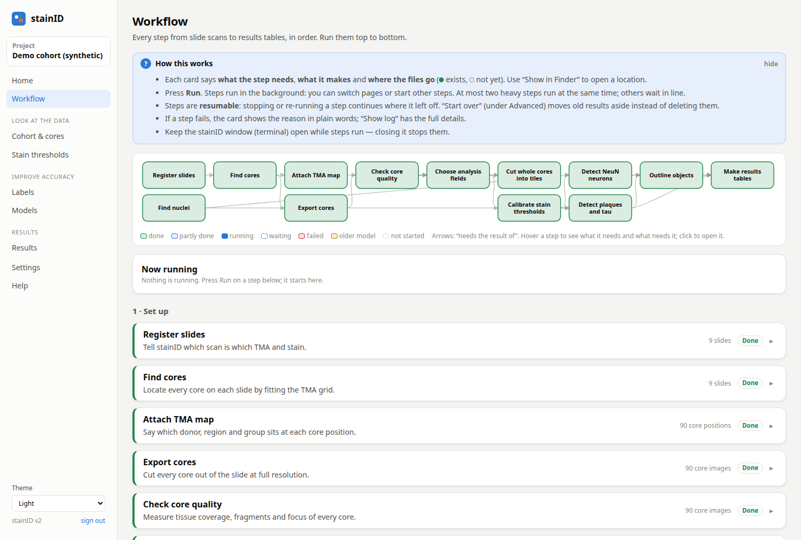

*The Run page: every step as a flow chart, the data each hands on along the arrows. Screenshots show a synthetic demo
project, not study data (see [The app](#the-app)).*

## Why stainID

- **Easy to set up.** Double-click to install, double-click to start. A guided setup reads your TMA maps from Excel,
  Word, CSV or even a photo, matches them to the slides, and tells you in plain words what does not fit.
- **One button to run.** *Run everything* runs every step in the right order. You can stop at any time and continue
  later, and you can close the browser while it works.
- **See what detection found.** Open any core and click any spot to see a full-resolution picture with every detection
  drawn on it.
- **Annotation built in.** Send colleagues a link. They correct stainID detection with one key per object, on their own fields,
  after a short tutorial, with no account.
- **Your staining, your models.** Train the detection models on the labels your team makes, compare the new model
  with the one in use, and switch only when it is better.
- **Simple by default, with full control.** Every page asks only what it needs. Technical options sit under
  *Advanced*, and every step is also a command.
- **Safe for your data.** Nothing is ever deleted: re-runs and uploads move old files aside with a date.

## What you can use it for

- **A TMA cohort study.** Get neuron counts, plaque and tau measures per donor and brain region, plotted by diagnostic
  group, with one table that opens in Excel, R or Python.
- **Whole-slide scans or folders of images.** The same analysis without a core grid: each slide is analysed region
  by region, and each image stands for one core.
- **Another lab's dataset.** Import a public or shared dataset package with its expert annotations. You get precision,
  recall, F1 and AUC against each rater and their consensus, next to how well the raters agree with each other.
- **A labelled training set.** Collect labels from several people, with repeat labels for agreement and every label
  traceable to who made it and when.
- **Better detection for your lab's staining.** Retrain the NeuN, 6E10 and AT8 models on your own slides.
- **An end-to-end accuracy check.** People outline every object in a few fields, with what detection found shown. The check then
  shows what detection missed, cut in two, merged or outlined poorly.

## Getting started

1. **Install once.** Download this repository (green *Code* button → *Download ZIP*), unzip it, and double-click
   **`Install stainID.command`** (macOS) or **`Install stainID.bat`** (Windows). The first time on macOS,
   right-click the file → *Open* to allow it.
2. **Start.** Double-click **`Start stainID.command`** (or `.bat`). stainID opens in your web browser. The admin
   password is `admin` until you change it in Settings. Keep the small terminal window open while you work: closing it
   stops running steps.
3. **Create a project** on the Projects page (*New study*). Give it a name, a place to keep it, and say what you will
   analyse: TMA slides, a folder of images, whole slides, or a dataset package.
4. **Follow the guided setup.** It has a few short screens. The slides are matched to their TMA and stain from lists,
   with a picture of each slide's label. The cores are found on every slide. The maps and the donor sheet are read
   from your files. A final check lists any problems, each with a fix. Then press *Run everything*.
5. **Follow the run** on the Run page. Each step shows its progress and a rough time left.
6. **Check, label, improve, and use the results.** Look at detections on the tissue (Cores). Ask colleagues to check
   detection's work (Labels), and train better models from their labels (Models). Then download the results table
   (Results).

The Help page in the app has the same guide, answers to common questions and a glossary. Adding slides to a running
study works the same way (Home → *Add slides*); see [Adding new slides to a study](docs/guide_adding_slides.md).

### What you need

| | Where it comes from |
|---|---|
| **Slide scans**, one per TMA and stain (`.vsi`, `.svs`, `.ndpi`, `.czi`, `.tif`, …), or a folder of images | your scanner |
| **TMA map**: which donor, brain region and diagnostic group sits at each core position | the maps your lab already has (Excel, Word or CSV), read by the guided setup; a map that is only a photo is typed into a grid |
| Donor information, optional (age, sex, APOE, PMI, …) | your case spreadsheet, read by the guided setup |
| **Stain models** (NeuN, 6E10, AT8) | trained in the app on objects you label, or copied from an earlier study with the same staining |
| **Published models** (Cellpose-SAM, Segment Anything, Phikon) | downloaded by the app (Models page) |
| Published plaque CNN weights (Wong et al. 2022; Tang et al. 2019), optional, used by the 6E10 model | copied by hand into `data/models/plaque_cnn` (they have no download link) |
| Python 3.10+, and Java for `.vsi` scans | [python.org](https://www.python.org/downloads/), [adoptium.net](https://adoptium.net) |

A laptop runs everything. An NVIDIA GPU makes the slow step, finding every cell, much faster: about 4 s per tile,
against about 90 s on a Mac's GPU.

## The workflow at a glance

| | What happens | Where |
|---|---|---|
| **1 Set up** | slides registered, cores found, maps and donors attached, every core cut into ~560 µm tiles, one stain threshold per slide (set blind to diagnosis) | Set up |
| **2 Detect** | every cell found with Cellpose-SAM, then every stained object proposed in every core, detection's call on each, and three Segment Anything outlines of the likely ones | Run |
| **3 Check** | every core with its detections, and the stain threshold of each slide | Cores, Stain thresholds |
| **4 Improve** | people check and correct detection's calls in annotation rounds; new models are trained from their labels and compared | Labels, Models |
| **5 Results** | one row per donor and brain region, every stain, with plots by group and what every column means | Results |

Steps run in the background in the right order, at most two heavy ones at a time. Every one can be stopped and
resumed. The full list of steps and their commands is [below](#every-step-and-its-command).

## Annotation: check and correct detection together

Labelling in stainID means **correcting stainID detection**, not starting from a blank picture. Every object detection considered is
already on the screen with its outline. People only fix what is wrong. A session takes a minute to make on the Labels
page:

1. **Choose a stain and what people should do.**
   - **Fix the field** (start here): the whole field with every object detection considered. People point at an
     object and press a key to change its call, fix its outline, or click to add what detection missed.
   - **Mark bad areas**: one core at a time with all its stains, brush only (the field tool's brush and keys): add to or
     take out of the areas of folds, artifacts, empty glass and blur, or press Enter when a stain looks fine. A sample of cores is enough.
2. **Choose where the fields come from**: every ready core, some TMAs, or squares you click on the cores. The same
   works for slides and images.
3. **Copy the link and the session's key, and send them.** People open the link, sign in or make an account, and add
   the set with its key. Annotator accounts see only the sets they joined; the rest of stainID is for admins.

What annotators see:

- **Everything, nothing hidden.** Every type is solid in its own colour; unsure is dotted amber with a "?". Dotted grey
  means not active: rejected by detection or by a person (Delete), or just added and waiting for its type. Pointing at
  an object lights it up, shows its name beside it and its facts at the side: class, detection's call and score, area,
  and which of its three outlines shows.
- **One key per object.** The keys act on the object under the mouse:

  | Key | What it does |
  |---|---|
  | **1–4** | its counted type (6E10: compact, diffuse, cored-neuritic, small; AT8: pretangle, mature tangle, ghost tangle; NeuN: neuron) |
  | **Q W E** | a named look-alike, not counted (6E10: CAA, staining inside a neuron; AT8: neuritic crown, tau in an astrocyte, thread) |
  | **`** (or 0) | unsure: dotted amber "?", left out of training and evaluation |
  | **Delete** | reject (not a plaque / tau / neuron): it turns dotted grey like detection's own rejects; a number key makes it solid again |
  | **Tab** / **Shift+Tab** | a bigger or smaller outline: each object has three Segment Anything outlines ready |
  | **Click** an object | precise editing of that object only: click a spot to add it, Shift+click one to leave it out, drag the dots (Z one step back); a click beyond the faint frame around it, or Enter, keeps it, Esc cancels |
  | **Space** | hide / show everything drawn over the picture, for a clean look at the tissue |
  | **[** / **]** | step 1 of every field: the acceptance threshold (where objects start), until *Start editing* or the first edit locks it |
  | **S** / **M** | split an object in two (a click and Enter, or a line across objects) / merge objects (click or drag over them, Enter) |
  | **B** | the brush: change the bad areas (1–4 the type while it is on; a drag adds to that type's area, Shift-drag takes out of it; Tab / Shift+Tab the brush size); they teach and test bad-area detection and their objects are left out of training and scoring — the analysis keeps detection's own areas |
  | **Z** | undo |
  | **Ctrl+S** / **Ctrl+Enter** | save / save and continue |

- **Click to add a missed object.** In *Fix the field*, a click on empty tissue outlines the object at once, because
  the Segment Anything features of each field are made ahead (on the GPU when there is one). It shows as a new
  candidate, dotted grey, until a class key makes it solid.
- **The page fits the window.** The picture is as large as the window allows and the side panel (the object, the class
  keys and colours, the keys, the field's progress, Save) scrolls on its own; longer help is behind **?**. Scroll to
  zoom, drag or hold the middle button to move the picture.
- **No collisions.** Each person is handed a field nobody else is working on, and a finished field is not handed out
  again. Under *Advanced* you can ask for two or more people per field, to measure agreement.
- **Nothing is saved by accident.** Changes stay on the page, with a count of unsaved changes, until *Save* or *Save
  and continue*. A reload brings unsaved work back. *Save and continue* counts every call you left as it is as checked
  by you, and opens the next field.
- **A tutorial the first time.** A new name first goes through a short practice on a real field of the project (about
  3–5 minutes, where nothing is saved), also when they arrive by a session's own link. The coach asks for one thing at
  a time; *Tutorial* at the top shows it again. *Try the tutorial* on the Labels page shows the admin the same practice.

Both rounds write one shared set of answers, so no object is asked about twice, and labels made earlier are matched
onto detection's candidates. The Labels page follows progress field by field and person by person. It also shows how
often people agree with detection, and the labels train a new model on the Models page. The classes and their types
(e.g. *tau+ neuron · pretangle*) can be changed in Settings ([label classes](docs/label_classes.md)). The older kinds
of session (whole-field review, a quick object queue, and *Outline every object* for the segmentation check) are under
*Advanced*.

The rounds work on the candidates of the staged detection ([below](#detection-stage-by-stage)), so a stain needs its
*Find candidates* and *Decide* steps run first (*Run what's left* does it). To try the rounds before that, run
`stainid labels store-from-pool`.

## Image sets, whole slides and other labs' datasets

A study does not have to be a TMA. *New study* asks what you will analyse:

| Kind | What it is | Set up |
|---|---|---|
| **TMA study** | slide scans of tissue microarrays and their TMA maps | Slides → Cores → Map → Donors → Checks → Run |
| **Image set** | a folder of image tiles or regions, each from a known donor | Images → Donors → Checks → Run |
| **Whole slides** | whole-slide scans (.svs, .ndpi, .tif, .czi, OME-Zarr); the tissue of each slide is analysed region by region | Slides → Donors → Checks → Run |
| **From a dataset package** | a public or shared dataset described by `dataset.yaml`, `images.csv`, `annotations.csv` and `donors.csv` | made for you; then as an image set or whole slides |

Image sets and whole slides have no map and no core grid. Each image, or each region of tissue, takes the place of a
core, so detection, results, labels, annotation rounds, models and the viewer work the same.

For each study you say three things: what each stain is (6E10-type, AT8-type, NeuN), the colour it was developed in
(brown DAB, Fast Red, NovaRed, a blue chromogen, or one of two colours on one slide), and the pixel size. stainID
brings every image to the models' scale and colours without copying the files.

A dataset package may arrive piece by piece. Images not downloaded yet are listed as such, and *Look for new files*
adds them as they come. Its annotations become one read-only labelling session per rater, plus their consensus.
*Models → Score the models on these labels* then tests the models on another lab's data. Whole slides need
`pip install "stainid[slides]"`. See [docs/project_kinds.md](docs/project_kinds.md).

## Several people, several studies

One stainID server serves a whole lab:

- Anyone on the network opens `http://<the computer running stainID>:8765`.
- Each study has its own address (`/p/<project>/…`), so people can work in different studies side by side.
- Heavy steps take turns over all studies, so the computer stays usable.
- One sign-in for everyone: admins see everything, annotators only the labelling sets they joined with a key.

The pictures the app makes for viewing are kept within a space limit per study (100 GB by default; Settings →
Advanced). The least recently used pictures go first and are made again when someone needs them; study data and
results are never touched. See [docs/webapp.md](docs/webapp.md).

## The app

All screenshots show a synthetic demo project: the tissue images, donors, labels and results are generated by
[tools/demo/make_demo_project.py](tools/demo/make_demo_project.py) and contain no study data.

| | |
|---|---|
| 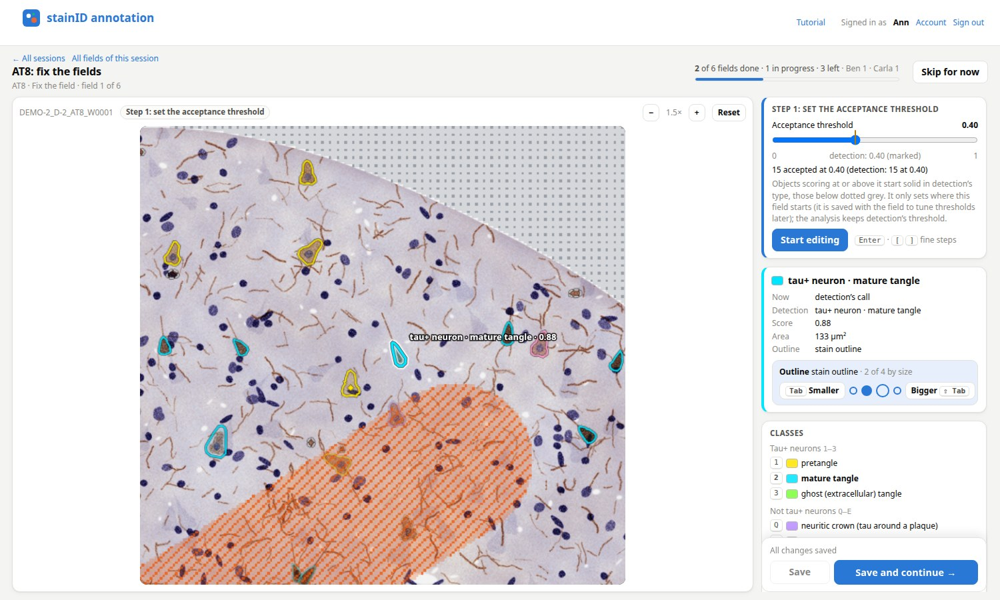 | 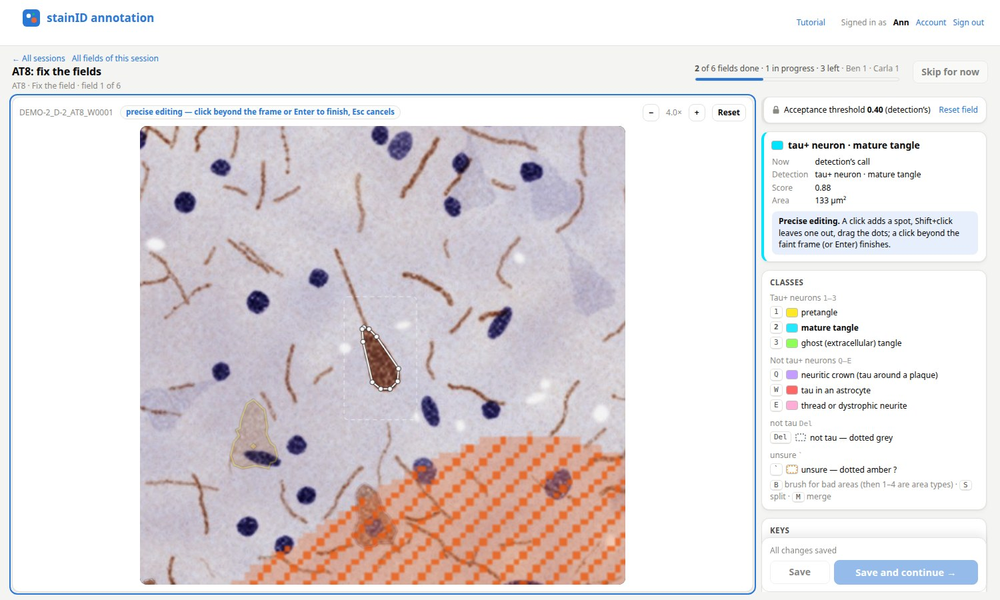 |
| **Fix the field** (at `/p/<project>/annotate`): every candidate of the field, solid in its class colour or dotted grey when rejected or removed; the object under the mouse lights up, its name beside it and its facts (class, detection's call and score, area, outline) in the side panel with the class keys and colours | **Precise editing** (click the object): only this object can change; a click adds a spot, Shift+click leaves one out, the white dots drag; a click beyond the faint frame keeps it |
| 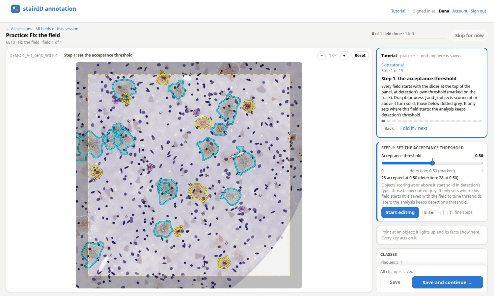 | |
| **Tutorial**: where a new annotator starts, on a practice field where nothing is saved; *Try the tutorial* on the Labels page shows it to the admin | |
| 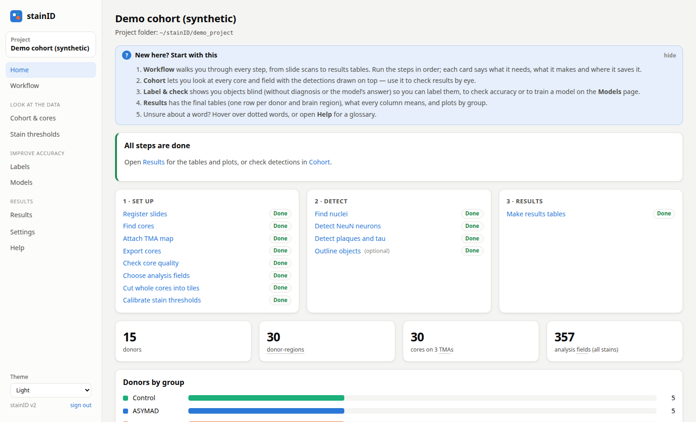 | 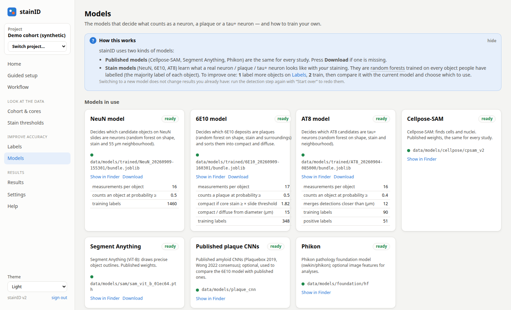 |
| **Home**: your next step and overall progress | **Models**: download published models; train from labels, compare, switch |
| 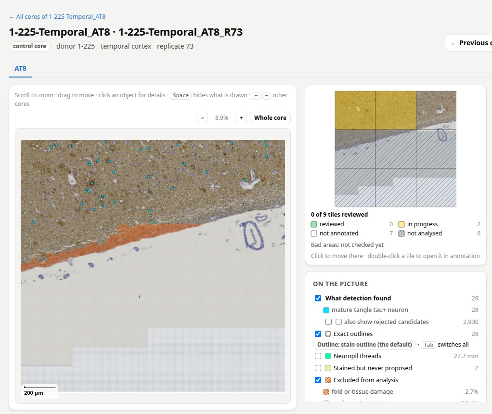 | 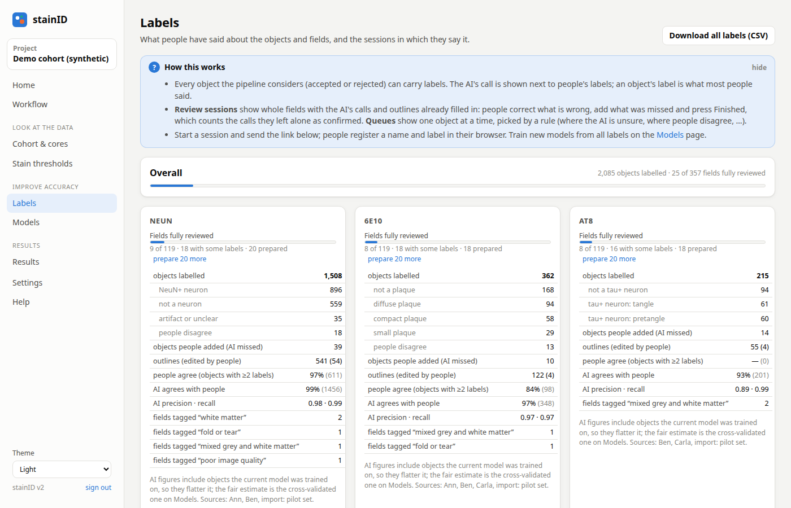 |
| **Cores**: the whole core; click any spot for a full-resolution preview with every candidate drawn on it (rejected ones dotted grey) | **Labels**: annotation rounds with their progress, agreement with detection, the link to share and *Try the tutorial* |
| 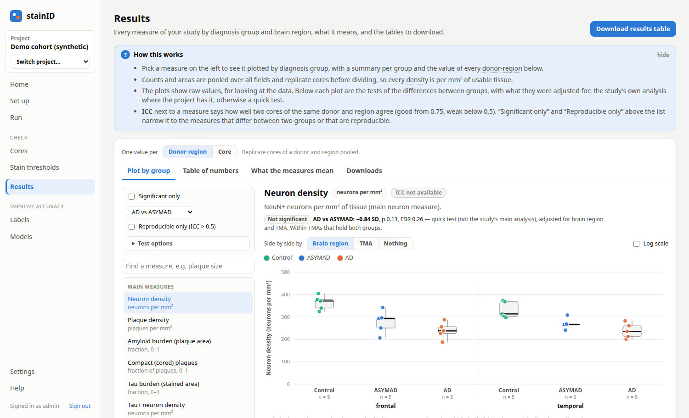 | 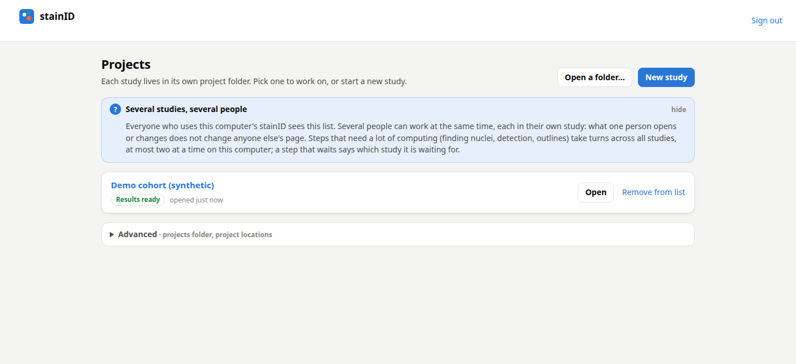 |
| **Results**: download the main table, what every column means, plots by group | **Projects**: every study with its status; new study, open a folder, switch |
| 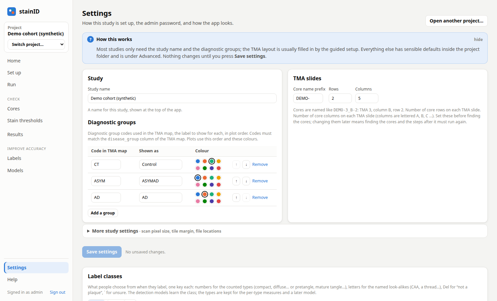 | |
| **Settings**: study layout, diagnostic groups, label classes and every file location | |

---

## For the technically minded

### Command line

```bash
git clone https://github.com/skysky2333/stainID.git && cd stainID
python -m venv .venv && source .venv/bin/activate
pip install -c constraints.txt -e ".[app,deep,slides]"   # constraints.txt: the versions the trained models need
stainid serve                              # the web app
stainid --project path/to/study status     # progress of every step
stainid --project path/to/study v2 status  # the staged detection: done / out of date per stage and stain
```

The install extras are:

- `slides` reads scanner files (Bio-Formats, which needs Java; OpenSlide and Zarr for whole-slide projects);
- `deep` adds PyTorch, Cellpose-SAM, Segment Anything and transformers;
- `app` is the web server;
- `dev` adds pytest and ruff.

Heavy steps can be split across processes or machines with `--shard-index/--shard-count`. The web app is committed
prebuilt, so Node is only needed to change the front end. A step run in a terminal shows up in the app's job list like
one started there.

### Every step and its command

| | Step | What it does | Command |
|---|---|---|---|
| **Set up** | Register slides | say which scan is which TMA and stain | *web app* |
| | Find cores | fit the TMA grid on each slide (the grid size is found when a slide has none set) | `stainid dearray` |
| | Attach TMA map | donor, brain region and diagnostic group for each core | `stainid layout` |
| | Export cores | native-resolution core images | `stainid export` |
| | Check core quality | tissue coverage, fragments, focus | `stainid qc` |
| | Cut cores into tiles | every ~560 µm tile of tissue in each core; detection looks at every one | `stainid tiles` |
| | Prepare images | image sets and whole slides: the analysis scale and colours, regions, tiles (replaces the five steps above) | `stainid images` |
| | Calibrate stain thresholds | one DAB threshold per slide from every tile of its cores, blind to diagnosis | `stainid calibrate` |
| **Detect** | Find nuclei | Cellpose-SAM cells for every stain; the slow step, the one to run on a GPU | `stainid nuclei` |
| | Find candidates | every stained object proposed generously and measured; nothing decided yet | `stainid v2 proposals` |
| | Decide | the stain model and rules call every candidate, from the saved measurements | `stainid v2 calls` |
| | Outline objects | three Segment Anything outline sizes for the likely objects | `stainid v2 outlines` |
| **Results** | Make results tables | one row per donor and region (and per core), every stain, from the calls | `stainid v2 measures` |
| **Models** | Download public models | Cellpose-SAM, Segment Anything, Phikon | `stainid download-models` |
| | Prepare fields for labelling | candidates for the older kinds of labelling session | `stainid labels prepare` |
| | Train a model | train and compare a stain model from the labelling sessions you choose | `stainid train` |
| | Check segmentation | how well detection finds and outlines the objects people outlined | `stainid score-segmentation` |
| **Legacy (v1)** | Detect NeuN neurons (legacy v1) | the first detection: candidates + NeuN model | `stainid neun` |
| | Detect plaques and tau (legacy v1) | the first detection: 6E10 plaques and morphotypes; AT8 tau+ neurons and threads | `stainid fields` |
| | Outline objects (legacy v1) | Segment Anything outlines of the first detection's objects | `stainid masks` |
| | Make results tables (legacy v1) | the first detection's tables (`data/analysis/results_*.csv`) | `stainid summarize` |

*Run everything* (*Run what's left* on the Run page) runs the Set up, Detect and Results steps. The legacy (v1)
detection steps are under *Advanced* on the Run page: still runnable one by one, never run by those buttons.
[docs/webapp.md](docs/webapp.md) explains the queue, and [docs/pipelines.md](docs/pipelines.md) says what each step
computes.

### Detection, stage by stage

The staged (v2) detection splits detection into stages. Each stage reads the saved outputs of the stage before it:
proposals → calls → outlines → measures. Every candidate is kept, accepted or rejected, with its outline,
measurements, detection's call and the reason for it. This store is what the viewer and the annotation rounds show.

Each stage writes a small manifest per core image. The manifest records the code version, the parameters and a
fingerprint of every input (the image, the slide threshold, the hand-drawn exclusions, the model and its cut-off, the
stage before). So stainID knows which cores are **out of date**, and a run redoes only those. After a new model or
rule, only the quick stages run again (minutes, with no image read).

```bash
tools/v2_run.sh all        # every stage: proposals on several cores at once, outlines on every GPU
tools/v2_run.sh decide     # only calls and measures, after a new model, cut-off or rule
tools/v2_run.sh status     # how far each stage has got
```

Outputs go to `data/analysis/v2/`; the Results page shows `v2/measures/` once it exists, and the legacy tables stay
as they were. See [docs/pipeline_v2.md](docs/pipeline_v2.md) for every stage, rule and output column.

### Documentation

Read in this order:

1. [Adding new slides to a study](docs/guide_adding_slides.md): the guided setup, step by step, for people new to stainID.
2. [Using the app](docs/webapp.md): every page, how steps are queued, annotation rounds, the segmentation check and training models.
3. [Label classes](docs/label_classes.md): the classes and types people label with, their keys, and how to change them.
4. [Project files](docs/project.md): the project settings (`stainid.yaml`), the input tables and every output file.
   [Project kinds](docs/project_kinds.md): image sets, whole slides, imaging settings, dataset packages and scoring on
   imported labels.
5. [Methods](docs/pipelines.md): what each step computes, with its parameters, and the models.
   [Staged detection (v2)](docs/pipeline_v2.md): stages, manifests, the candidate store and the measures.
6. [Development](docs/development.md): tests, front end, the API, caches and adding a step.

### Repository layout

```
src/stainid/
  project.py        stainid.yaml loading, saving and path resolution
  cli.py            the `stainid` command
  workflows/        every step (steps.py is the registry the CLI, job runner and web app share)
  jobs/             the job store shared by the web app and the command line
  setup/            the guided setup: reading maps, donor sheets and checks
  slides/           slides table, scan reading, dearraying, core export, TMA map
  imageset/         image sets, whole slides, dataset packages and scoring on their labels
  qc/               core QC, focus, artifact exclusions
  sampling/         field selection
  imaging/          colour deconvolution, tissue / fold / artifact masks, calibration
  nuclei.py         Cellpose-SAM cells (shared by every stain)
  stains/           neun/, amyloid/, tau/ stain-specific detection and classifiers
  v2/               staged detection: proposals, calls, outlines, measures, manifests
  candidates.py     the candidate store the v2 stages write
  masks/            Segment Anything outlines, shape features and click-to-outline
  labels/           label store, classes, annotation rounds and decisions, sessions, import of earlier label sets
  training/         candidate features and model training from the label store
  segmentation/     the segmentation check
  analysis/         core / donor-region aggregation and the column dictionary
  registration/     cross-stain core registration
  review/           blind review sets
  disk_cache.py     the space limit for pictures made for viewing
  api/              FastAPI backend (and the built web app in api/static)
webapp/             React + TypeScript front end
tools/              v2_run.sh, build_webapp.sh, demo/ (synthetic demo project, screenshots), qupath/
tests/              pytest suite (synthetic data only)
```

## Acknowledgements

`stainid/stains/amyloid/wong_consensus.py` is copied from the consensus-learning code of
Wong et al. (Keiser lab, [keiserlab/consensus-learning-paper](https://github.com/keiserlab/consensus-learning-paper)).
stainID uses the following published models; their weights are not redistributed here:

- Wong DR, Tang Z, Mew NC, et al. Deep learning from multiple experts improves identification of amyloid neuropathologies. *Acta Neuropathol Commun* 10, 66 (2022).
- Tang Z, Chuang KV, DeCarli C, et al. Interpretable classification of Alzheimer's disease pathologies with a convolutional neural network pipeline. *Nat Commun* 10, 2173 (2019).
- Pachitariu M, Rariden M, Stringer C. Cellpose-SAM: superhuman generalization for cellular segmentation. *bioRxiv* (2025).
- Kirillov A, Mintun E, Ravi N, et al. Segment Anything. *ICCV* (2023).
- Filiot A, Ghermi R, Olivier A, et al. Scaling self-supervised learning for histopathology with masked image modeling (Phikon). *medRxiv* (2023).

## License

BSD 2-Clause, see [LICENSE](LICENSE). Vendored third-party code keeps its original attribution.
